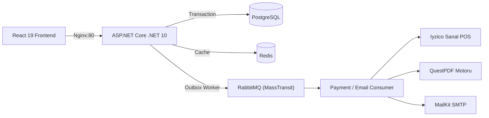

# YILDIRIM — Enterprise E-Commerce Platform

Clean Architecture ve Event-Driven mimari prensipleriyle geliştirdiğim, mikroservis/modüler monolit ölçeğinde dağıtık sistem dinamiklerini simüle eden full-stack bir e-ticaret uygulaması.

---

## Mimaride Neler Yaptım?

- **Clean Architecture & CQRS (MediatR):** İş kurallarını (Domain/Application) altyapıdan (Persistence/WebApi) tamamen izole ettim. Tüm komut (Command) ve sorgular (Query) tek sorumluluk ilkesine (SRP) uygun handler'lara ayrıldı.
- **Outbox Pattern:** Dağıtık veri tutarlılığı (Dual-Write problemi) için veritabanı işlemi ve fırlatılacak event aynı PostgreSQL transaction'ında kaydediliyor. Arka plandaki background worker mesajları garanti altına alarak RabbitMQ'ya basıyor.
- **Saga Orchestration & İade (Iyzico Sandbox):**
  - Sipariş oluşturulduğunda stok düşülür ve banka adımı asenkron yürütülür.
  - Ödeme başarısız olursa telafi edici işlem (compensating transaction) çalışıp stokları otomatik iade eder.
  - İptal edilen siparişlerde Iyzico Cancel/Refund API tetiklenerek tutar karta iade edilir ve stoklar depoya geri yüklenir.
- **QuestPDF ile Bellek-İçi E-Fatura Motoru:** Sipariş tamamlandığında vektörel A4 kurumsal fatura diske yazılmadan doğrudan bellekte (RAM) üretilip kullanıcıya sunulur.
- **Asenkron Bildirim & E-Posta (MailKit):** Ödeme tamamlandıktan sonra RabbitMQ tüketicisi (`PaymentCompletedConsumer`) devreye girer; PDF faturayı ekleyerek müşteriye arka planda e-posta iletir.
- **Dağıtık Önbellekleme (Redis):** Vitrin ürün listelemeleri, kategori filtreleri ve arama sonuçları Redis üzerinde önbelleklenir. Yeni ürün eklendiğinde veya stok değiştiğinde cache otomatik geçersiz kılınır (Cache Invalidation).
- **Canlı Stok Takibi (SignalR):** Sipariş verildiğinde veya iptal edildiğinde diğer bağlı müşterilerin vitrini sayfa yenilenmeden anlık güncellenir.
- **Idempotency & Concurrency:** Çift tıklama ya da ağ tekrarı riskine karşı `Idempotency-Key` başlığı ve eşzamanlı stok yarışlarını engellemek için PostgreSQL optimistik kilitleme (`RowVersion`) uygulandı.

---

## Teknoloji Yığını

- **Backend:** .NET 10 (C#), ASP.NET Core Minimal APIs / MediatR, FluentValidation, Entity Framework Core
- **Frontend:** React 19, Vite, Tailwind CSS, Lucide Icons
- **Veritabanı & Altyapı:** PostgreSQL 16, Redis 7, RabbitMQ (MassTransit), Nginx (Reverse Proxy)
- **Harici Entegrasyonlar:** Iyzico API (Sandbox), QuestPDF, MailKit / MimeKit
- **Konteynerizasyon:** Docker & Docker Compose

---

## Mimari Akış



---

## Kurulum ve Yerelde Çalıştırma

Projeyi tek bir komutla ayağa kaldırmak için ortamda **Docker Desktop** bulunması yeterlidir:

1. Depoyu klonlayın:
   ```bash
   git clone https://github.com/kullanici-adiniz/EnterpriseECommerce.git
   cd EnterpriseECommerce
   ```

2. Ortam değişkenlerini hazırlayın:
   ```bash
   cp .env.example .env
   ```
   *(Kendi test Iyzico veya SMTP bilgilerinizi `.env` içerisine girebilirsiniz. Girilmezse sistem fallback modunda güvenle çalışır.)*

3. Tüm servisleri Docker Compose ile ayağa kaldırın:
   ```bash
   docker compose up -d --build
   ```

4. Tarayıcıdan erişin:
   - **Frontend (Mağaza):** `http://localhost`
   - **Backend API:** `http://localhost:5041`
   - **RabbitMQ Dashboard:** `http://localhost:15672` (Kullanıcı adı/şifre `.env` dosyasında)

